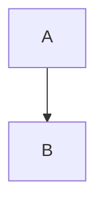

# Highlighted code

```python
def greet(name):
    """Say hello."""
    return f"Hello, {name}!"  # comment
```

```bash
for f in *.md; do echo "$f"; done
```

```csharp
public static int Add(int a, int b) => a + b;
```

```txt
plain text, no tokens
```



```javascript
```

- item

  ```json
  {"key": [1, true, null]}
  ```

A trailing blank line inside the fence:

```python
x = 1

```
